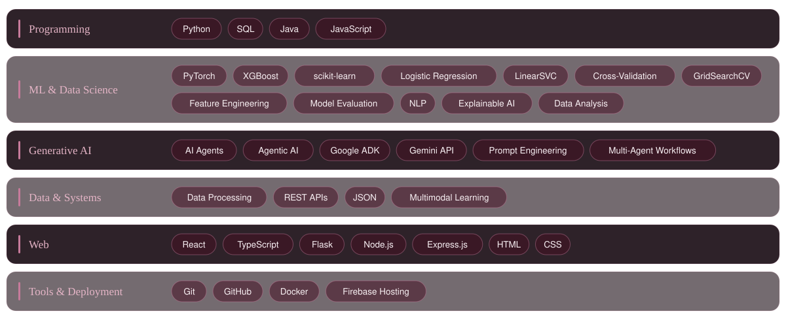
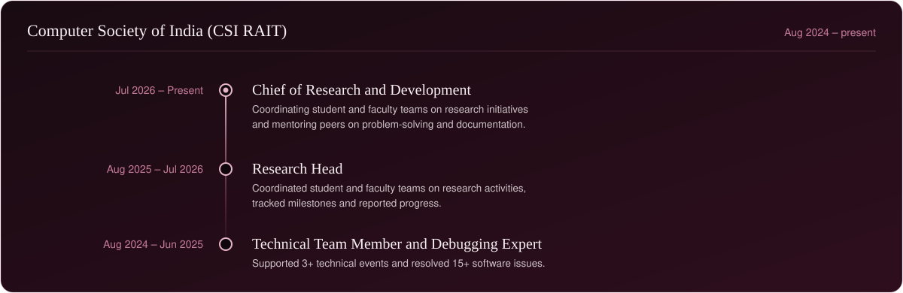
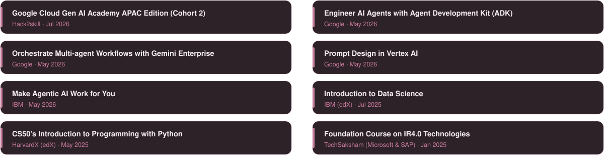

 

Final-year Computer Engineering undergraduate (Minor in Data Science) at Ramrao Adik Institute of Technology, D.Y. Patil Deemed to be University. I build machine learning models, multimodal classification pipelines and full-stack applications, and I lead research and technical teams at CSI RAIT. Currently seeking a Data Science / AI internship.

 

  <!-- TODO: wrap a card in a link once you have the URL, e.g.
        -->
  
  
  
  

 

 

 

 

<!-- If a stats card ever breaks, delete that line rather than leave a broken image. -->

  
  

 

  
  &nbsp;
  

